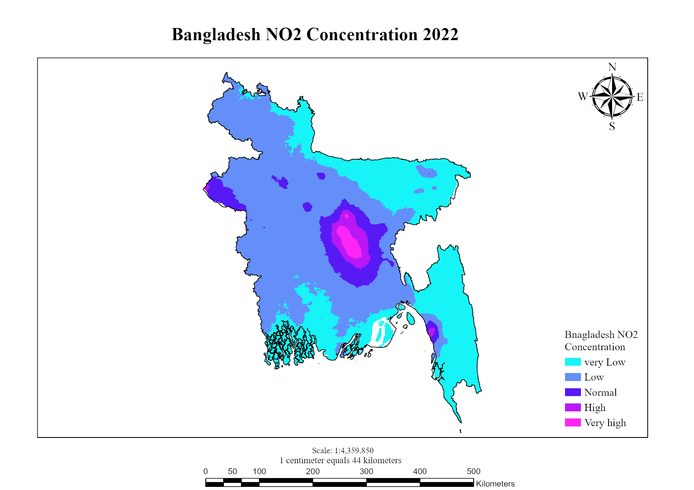

# Tropospheric NO₂ Mapping, Bangladesh (Jan-May 2022)

## Overview
Mean tropospheric NO₂ column density across Bangladesh from January to May 2022, mapped from Sentinel-5P TROPOMI data in Google Earth Engine to identify urban-industrial emission hotspots.

## Data
- Sentinel-5P TROPOMI NO₂ (`COPERNICUS/S5P/OFFL/L3_NO2`)
- Bangladesh boundary
- Period: January-May 2022

## Method
1. Filtered the Sentinel-5P collection to the study period and area of interest.
2. Computed the 5-month mean NO₂ composite.
3. Clipped the raster to Bangladesh and applied a custom color palette.
4. Exported the raster to Google Drive [at 30 m, resampled for layout; native resolution is about 5.5 km].
5. Built the final map layout in ArcGIS Pro.

## Key findings
- Highest NO₂ (about 0.00015-0.00020 mol/m²) is concentrated over the Greater Dhaka corridor (Dhaka, Narayanganj, Gazipur) and the Chattogram port zone.
- Rural and agricultural districts stay low (below 0.00005 mol/m²).
- The Jan-May window covers the shift from dry-season pollution to pre-monsoon dispersion.

## Tools
Google Earth Engine (JavaScript), ArcGIS Pro

## Links
- [GEE code](https://code.earthengine.google.com/526cc6202d8853b2694917c6b5aa8b46)
- [Download project package (137 MB, opens in ArcGIS Pro)](https://drive.google.com/file/d/1JfApBnT8wfe5sM9OiQ2AGrR5wfaYYnuM/view?usp=sharing)

## Limitations
Sentinel-5P has a coarse native resolution (about 5.5 km), so the map shows regional patterns, not neighborhood-level detail.
